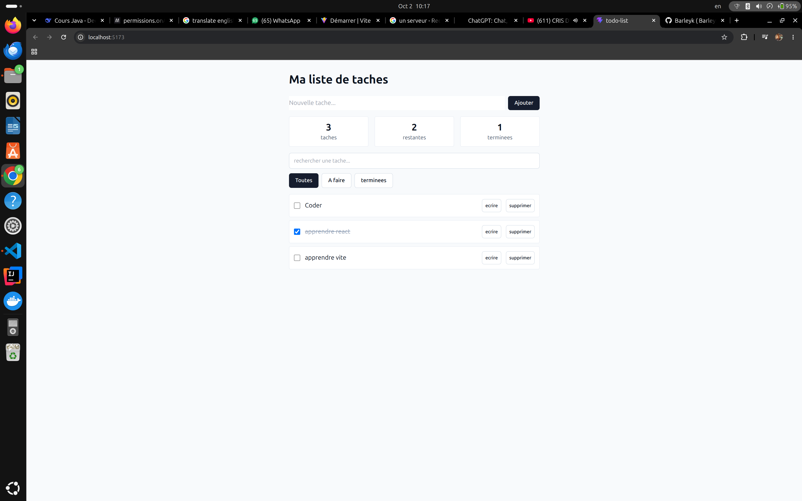
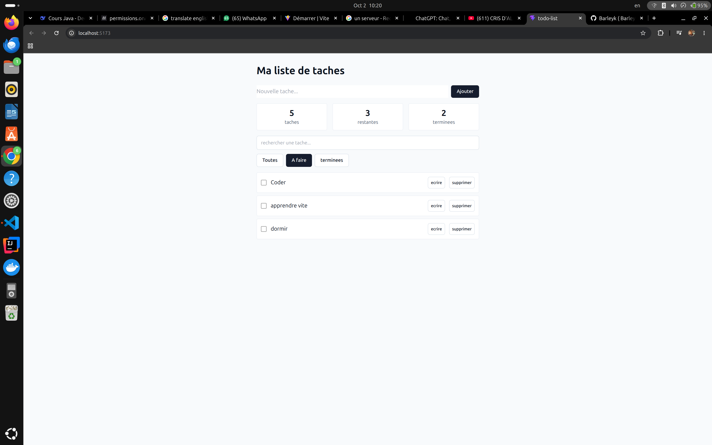
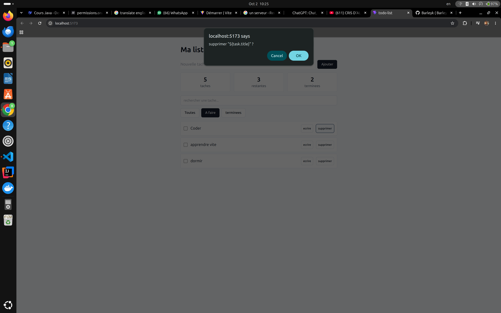

# TodoList React

Application de gestion de tâches personnelles en React + TypeScript.

## Description

Application web frontend permettant de créer, consulter, modifier, terminer, filtrer et supprimer des tâches. Le projet met en pratique les fondamentaux de React avec une architecture en composants claire.

## Fonctionnalités

- Créer une tâche (avec validation)
- Afficher la liste des tâches
- Marquer une tâche comme terminée
- Modifier le titre d'une tâche
- Supprimer une tâche (avec confirmation)
- Filtrer les tâches (Toutes / À faire / Terminées)
- Rechercher une tâche par titre
- Compteurs (total, à faire, terminées)
- Persistance des données via localStorage
- Interface responsive
- Accessibilité (aria-labels)

## Technologies

- **React 18** — Bibliothèque UI
- **TypeScript** — Typage statique
- **Vite** — Build tool
- **Tailwind CSS** — Styles utilitaires

## Architecture

```
src/
├── components/
│   ├── ui/
│   │   ├── button.tsx
│   │   └── input.tsx
│   ├── TaskForm.tsx
│   ├── TaskItem.tsx
│   ├── TaskList.tsx
│   ├── TaskFilters.tsx
│   └── TaskSummary.tsx
├── lib/
│   ├── storage.ts
│   └── utils.ts
├── types/
│   └── task.ts
├── App.tsx
└── main.tsx
```

## Installation

### Prérequis

- Node.js 20+
- npm 10+

### Lancer le projet

```bash
git clone https://github.com/Barleyk/todo-list.git
cd todo-list
npm install
npm run dev
```

Ouvrir [http://localhost:5173](http://localhost:5173) dans le navigateur.

### Build production

```bash
npm run build
npm run preview
```

## Utilisation

1. **Ajouter une tâche** : saisir un titre + cliquer "Ajouter"
2. **Cocher une tâche** : cliquer sur la case à gauche
3. **Éditer** : cliquer sur "Écrire"
4. **Supprimer** : cliquer sur "Supprimer" + confirmer
5. **Filtrer** : cliquer sur les boutons (Toutes / À faire / Terminées)
6. **Rechercher** : taper dans le champ de recherche

## Aperçu

### Liste des tâches


### Filtre actif


### Édition


## Auteur

**Barley Kapoya**

- GitHub : [@Barleyk](https://github.com/Barleyk)
- Localisation : Lubumbashi, RDC

## Licence

ISC